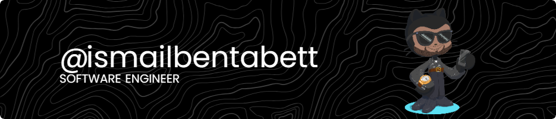

  
  
  

  
  
  
  

---

## 👋 About me

I'm **Ismail Bentabet**, a full-stack engineer with a frontend focus. I build fast, clean web apps with **React / Next.js**, **Vue / Nuxt** and **Laravel**, and I also handle the backend, tests and CI that go with them.

- 🏗️ **Founder of Site Sledge**: websites and automation for small businesses.
- 💼 **Freelancing since 2019**: **1,404 hours** on Upwork, **100% Job Success**, **$30K+** earned.
- 🎓 **BSc in Computer Science**, Université Dr Moulay Tahar de Saida.
- 🌍 Remote (UTC+1), open to relocation with visa sponsorship. I speak Arabic, English and French.

---

## 🛠️ Tech stack

   
   
  

  
  
  
  
  
  
  
  
  
  
  
  
  
  
  
  
  

---

## 💼 Experience highlights

| Role | Stack | Highlights |
|---|---|---|
| **Founder** · Site Sledge *(2026 – now)* | Next.js, GoHighLevel, automation | Websites and automation for small businesses |
| **Frontend Developer** · Merchwell *(Jul 2025 – Jun 2026)* | Next.js, React | Frontend for a merch storefront |
| **Frontend Developer** · Maildroppa | Next.js, Tailwind, Directus | ~25% more demo sign-ups; React email builder |
| **Frontend Developer** · Monday Merch | Nuxt, Vue, Pinia | ~40% faster page loads; ~30% more engagement |
| **Full-Stack Developer** · Telecom Radio Professionnel (Motorola Solutions partner) | Laravel, Vue, Inertia, Tailwind, Filament | Modular CMS with e-commerce and AI content tools ([trp-project](https://github.com/ismailbentabett/trp-project)) |
| **Developer** · SIG Service | Vue, Capacitor, Odoo, GitLab CI/CD | CI pipeline cut from ~20 min to ~10 min |
| **Co-founder** · Shortcut *(2020 – 2023)* | Vue, Nuxt, NestJS | Built the product MVP |

---

## ⭐ Featured projects

  
  
  
  
  
  

| Project | What it is | Stack | Links |
|---|---|---|---|
| **[Mosaic](https://github.com/ismailbentabett/mosaic)** | Self-hosted "everything app": tasks, calendar, habits, money, food, gym and notes, with a chat-first UI and a 156-tool MCP server | TypeScript, React, Hono, Mantine, SQLite | [Live demo](https://ismailbentabett.github.io/mosaic/) |
| **[ResumifyAI](https://github.com/ismailbentabett/ResumifyAI)** | AI resume reviewer | TypeScript | [Live](https://resumify-ai.vercel.app) |
| **[TRP Project](https://github.com/ismailbentabett/trp-project)** | Modular CMS: e-commerce, AI content, social integrations | Laravel, Filament, Vue, Tailwind | — |
| **[Site Sledge Plan Center](https://github.com/ismailbentabett/sitesledge-plan-center)** | Plan center for Site Sledge clients | TypeScript | [Live](https://sitesledge-plan-center.vercel.app) |
| **PawTalk** ([mobile](https://github.com/ismailbentabett/pawtalk-mobile) · [dashboard](https://github.com/ismailbentabett/pawtalk-dashboard) · [landing](https://github.com/ismailbentabett/pawtalk-landing)) | Pet app: mobile app, admin dashboard and landing page | TypeScript, React Native | [Dashboard](https://pawtalk-dashboard.vercel.app) · [Landing](https://pawtalk-landing.vercel.app) |
| **[Nebula](https://github.com/ismailbentabett/nebula)** | CSS/SCSS extractor for Vue, React, Svelte and Angular components | TypeScript, Node.js | npm `@ismailbentabett/nebula` |
| **[SMS Dashboard](https://github.com/ismailbentabett/sms-dashboard)** | Read-only analytics for cold-SMS campaigns | Next.js, PostgreSQL, GoHighLevel API | — |
| **[Aqua Flow](https://github.com/ismailbentabett/aqua-flow-hydration-marketing-focused-app)** | Marketing site for a hydration app | Next.js, Tailwind, Docker | [Live](https://aqua-flow-hydration-marketing-focused-app.vercel.app) |
| **[Demo Homepage Studio](https://github.com/ismailbentabett/demo-homepage-studio)** | Concept demo: homepage designs for local businesses | HTML, CSS | [Live](https://demo-homepage-studio.vercel.app) |

---

## 📂 All public projects

<b>🌐 Web apps & products</b>

| Repo | Description | Language | Stars |
|---|---|---|---|
| [mosaic](https://github.com/ismailbentabett/mosaic) | Self-hosted everything app with an MCP server | TypeScript |  |
| [ResumifyAI](https://github.com/ismailbentabett/ResumifyAI) | AI resume reviewer | TypeScript |  |
| [trp-project](https://github.com/ismailbentabett/trp-project) | Modular Laravel + Filament CMS with e-commerce and AI tools | JavaScript |  |
| [sitesledge-plan-center](https://github.com/ismailbentabett/sitesledge-plan-center) | Site Sledge client plan center | TypeScript |  |
| [sms-dashboard](https://github.com/ismailbentabett/sms-dashboard) | SMS campaign analytics (GoHighLevel API) | TypeScript |  |
| [pawtalk-mobile](https://github.com/ismailbentabett/pawtalk-mobile) | PawTalk mobile app | TypeScript |  |
| [pawtalk-dashboard](https://github.com/ismailbentabett/pawtalk-dashboard) | PawTalk admin dashboard | TypeScript |  |
| [pawtalk-landing](https://github.com/ismailbentabett/pawtalk-landing) | PawTalk landing page | TypeScript |  |
| [aqua-flow-hydration-marketing-focused-app](https://github.com/ismailbentabett/aqua-flow-hydration-marketing-focused-app) | Hydration app marketing site | TypeScript |  |
| [demo-homepage-studio](https://github.com/ismailbentabett/demo-homepage-studio) | Concept demo homepages | HTML |  |
| [a2p-wizard-website](https://github.com/ismailbentabett/a2p-wizard-website) | A2P wizard website | HTML |  |
| [isiconic_web_app](https://github.com/ismailbentabett/isiconic_web_app) | Social network + multi-vendor marketplace | Vue |  |
| [shopping-cart-vue-vuetify-firebase](https://github.com/ismailbentabett/shopping-cart-vue-vuetify-firebase) | Shopping cart with Vue, Vuetify and Firebase | Vue |  |
| [laravel-instagram-clone](https://github.com/ismailbentabett/laravel-instagram-clone) | Instagram clone in Laravel | PHP |  |
| [Screamer](https://github.com/ismailbentabett/Screamer) | Twitter-style social platform | C# |  |
| [sweetr](https://github.com/ismailbentabett/sweetr) | Twitter-style app with Solid and Firebase | PHP |  |
| [NeverNote](https://github.com/ismailbentabett/NeverNote) | Minimal note-taking app | TypeScript |  |
| [Concours](https://github.com/ismailbentabett/Concours) | Event site for a fashion contest (Laravel) | Blade |  |
| [ismailbentabett.github.io](https://github.com/ismailbentabett/ismailbentabett.github.io) | Portfolio site | CSS |  |

<b>🧰 Tools & technical challenges</b>

| Repo | Description | Language | Stars |
|---|---|---|---|
| [nebula](https://github.com/ismailbentabett/nebula) | CSS/SCSS extractor for component frameworks | TypeScript |  |
| [pack-builder-ultimate](https://github.com/ismailbentabett/pack-builder-ultimate) | Pack builder | — |  |
| [fluentpet-test](https://github.com/ismailbentabett/fluentpet-test) | Pet manager app, Expo technical challenge | TypeScript |  |
| [assessment-solution-aventique](https://github.com/ismailbentabett/assessment-solution-aventique) | Technical assessment (Vite + TypeScript) | TypeScript |  |

<b>📱 Mobile</b>

| Repo | Description | Language | Stars |
|---|---|---|---|
| [Movie-Info](https://github.com/ismailbentabett/Movie-Info) | Movie info app | Dart |  |
| [Bmi-Calculator-App](https://github.com/ismailbentabett/Bmi-Calculator-App) | BMI calculator app | Dart |  |
| [flutter-todo-app-ki-chghol](https://github.com/ismailbentabett/flutter-todo-app-ki-chghol) | To-do app | Dart |  |
| [react-native-todo-app](https://github.com/ismailbentabett/react-native-todo-app) | To-do app in React Native | JavaScript |  |

<b>🎓 University & course projects</b>

| Repo | Description | Language | Stars |
|---|---|---|---|
| [java-gui-project-Tp-SI-2021](https://github.com/ismailbentabett/java-gui-project-Tp-SI-2021) | Java GUI university project | Java |  |
| [gauss-elimination-method](https://github.com/ismailbentabett/gauss-elimination-method) | Gauss elimination method | Python |  |
| [shadok](https://github.com/ismailbentabett/shadok) | Shadok exercise in C | C |  |
| [profiles-rest-api-django](https://github.com/ismailbentabett/profiles-rest-api-django) | Profiles REST API (course project) | Python |  |
| [jenkins-devops-microservice](https://github.com/ismailbentabett/jenkins-devops-microservice) | Jenkins pipeline (course project) | Java |  |
| [azure-devops-kubernetes-terraform-pipeline](https://github.com/ismailbentabett/azure-devops-kubernetes-terraform-pipeline) | Azure DevOps pipeline (course project) | Java |  |
| [ng-asp-todo-app](https://github.com/ismailbentabett/ng-asp-todo-app) | Angular + ASP.NET to-do app (training) | TypeScript |  |
| [.NET-Microservices-Learning-Repo](https://github.com/ismailbentabett/.NET-Microservices-Learning-Repo) | .NET microservices course code (training) | C# |  |
| [Clean-Architecture-DDD-Learning-Repo](https://github.com/ismailbentabett/Clean-Architecture-DDD-Learning-Repo) | Clean Architecture & DDD course code (training) | C# |  |
| [BuberDinner](https://github.com/ismailbentabett/BuberDinner) | Clean Architecture REST API course code (training) | C# |  |
| [PropertiesToday](https://github.com/ismailbentabett/PropertiesToday) | Layered Web API course code (training) | C# |  |

---

## 🌍 Open source

Forks I work from, including the Arabic React and Vue docs:

---

## 📊 GitHub stats

  
  

  

  

  

---

## 🎓 Education & training

- **BSc in Computer Science**, Université Dr Moulay Tahar de Saida
- Completed courses: Zero To Mastery (web development, Angular), freeCodeCamp

---

### 🤝 Let's work together

Need a web app, a faster frontend or automation that saves hours? Reach me through my **[portfolio](https://ismailbentabett.com)** or **[LinkedIn](https://www.linkedin.com/in/ismailbentabett/)**.

