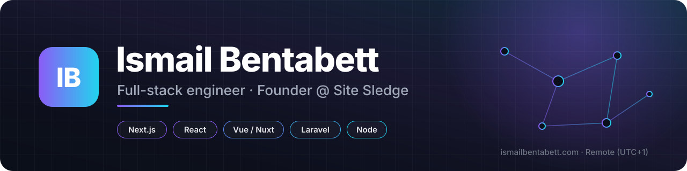

  
  
  
  
  

I'm a **full-stack engineer with a frontend focus** and the **founder of Site Sledge**, where I build websites and automation for small businesses. I ship fast, clean products with **Next.js, React, Vue/Nuxt and Laravel**, and I own the backend, tests and CI that go with them.

- **Freelancing since 2019**: 1,404 hours on Upwork, 100% Job Success, $30K+ earned.
- **Product builder**: co-founded Shortcut (2020 to 2023) and built its MVP; now running Site Sledge.
- **BSc in Computer Science**, Université Dr Moulay Tahar de Saida. I work in Arabic, English and French, and I'm open to relocation with visa sponsorship.

## What I build

- **Product frontends that convert**: Next.js and Nuxt storefronts and marketing sites tuned for speed (around 40% faster page loads at Monday Merch, around 25% more demo sign-ups at Maildroppa).
- **Full-stack business apps**: Laravel + Filament + Inertia/Vue back offices, CMSs and e-commerce, like the modular CMS I built for a Motorola Solutions partner.
- **AI and automation**: LLM features on the OpenAI API, MCP servers for agents, and n8n / GoHighLevel workflows that take manual work off small teams.
- **Delivery pipelines**: Docker, GitLab CI and GitHub Actions; I cut one client's CI pipeline from around 20 minutes to around 10.

## Tech stack

| Area | Tools |
|---|---|
| **Languages** |        |
| **Frontend** |        |
| **Mobile** |    |
| **Backend** |        |
| **Data** |         |
| **AI** |   |
| **DevOps** |       |

## Featured projects

<table>
  <tr>
    <td width="50%" valign="top">
      <a href="https://github.com/ismailbentabett/mosaic"><b>Mosaic</b></a> 
      The everything app: tasks, calendar, habits, money, food, gym and notes in one self-hosted SQLite app with a chat-first UI and a 156-tool MCP server.  
      
      
      
      
      
    </td>
    <td width="50%" valign="top">
      <a href="https://github.com/ismailbentabett/trp-project"><b>TRP Project</b></a> 
      Modular CMS for a Motorola Solutions partner: e-commerce management, AI content generation and social media integrations.  
      
      
      
      
      
    </td>
  </tr>
  <tr>
    <td width="50%" valign="top">
      <a href="https://github.com/ismailbentabett/ResumifyAI"><b>ResumifyAI</b></a> 
      AI resume reviewer that scores a resume and returns concrete, actionable feedback.  
      
      
      
      
    </td>
    <td width="50%" valign="top">
      <a href="https://github.com/ismailbentabett/Screamer"><b>Screamer</b></a> 
      Twitter-style microblogging platform on a Clean Architecture .NET API with an Angular client.  
      
      
      
      
    </td>
  </tr>
  <tr>
    <td width="50%" valign="top">
      <a href="https://github.com/ismailbentabett/isiconic_web_app"><b>Isiconic</b></a> 
      Social commerce platform: a social network combined with a multi-vendor marketplace.  
      
      
      
      
      
    </td>
    <td width="50%" valign="top">
      <a href="https://github.com/ismailbentabett/laravel-instagram-clone"><b>Laravel Instagram Clone</b></a> 
      Photo-sharing social app modelled on Instagram, built as a Laravel reference implementation.  
      
      
      
    </td>
  </tr>
  <tr>
    <td width="50%" valign="top">
      <a href="https://github.com/ismailbentabett/shopping-cart-vue-vuetify-firebase"><b>Vue Shopping Cart</b></a> 
      Storefront and shopping cart with a Firebase backend and Material UI components.  
      
      
      
    </td>
    <td width="50%" valign="top">
      <a href="https://github.com/ismailbentabett/profiles-rest-api-django"><b>Profiles REST API</b></a> 
      User profiles API with token authentication, built on Django REST Framework.  
      
      
      
    </td>
  </tr>
</table>

<a href="https://github.com/ismailbentabett?tab=repositories&type=source">Browse all public repositories &rarr;</a>

## Experience

| Role | Stack | Highlights |
|---|---|---|
| **Founder**, Site Sledge *(2026 to now)* | Next.js, GoHighLevel, automation | Websites and automation for small businesses |
| **Frontend Developer**, Merchwell *(Jul 2025 to Jun 2026)* | Next.js, React | Frontend for a merch storefront |
| **Frontend Developer**, Maildroppa | Next.js, Tailwind, Directus | Around 25% more demo sign-ups; React email builder |
| **Frontend Developer**, Monday Merch | Nuxt, Vue, Pinia | Around 40% faster page loads; around 30% more engagement |
| **Full-Stack Developer**, Telecom Radio Professionnel | Laravel, Vue, Inertia, Filament | Modular CMS with e-commerce and AI content tools |
| **Developer**, SIG Service | Vue, Capacitor, Odoo, GitLab CI/CD | CI pipeline cut from around 20 to around 10 minutes |
| **Co-founder**, Shortcut *(2020 to 2023)* | Vue, Nuxt, NestJS | Built the product MVP |

## GitHub stats

  
  

  

  

## Let's connect

  
  
  
  

Need a web app, a faster frontend or automation that saves hours? Reach out through <a href="https://ismailbentabett.com">my site</a> or <a href="https://www.linkedin.com/in/ismailbentabett/">LinkedIn</a>.

